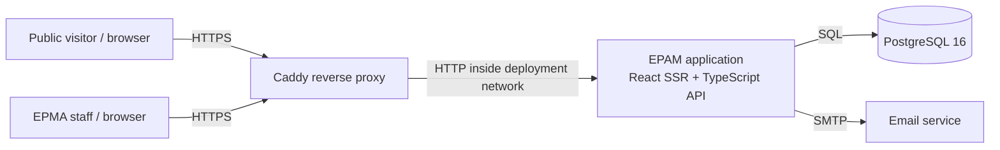
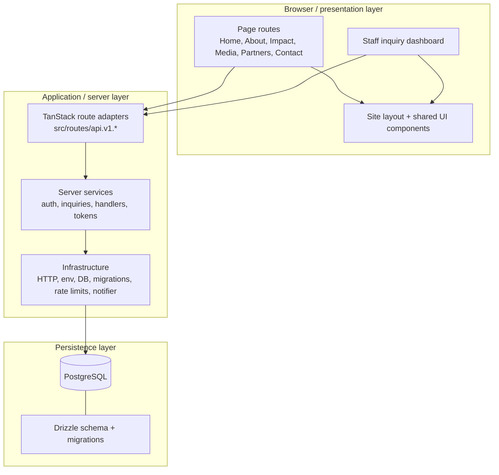
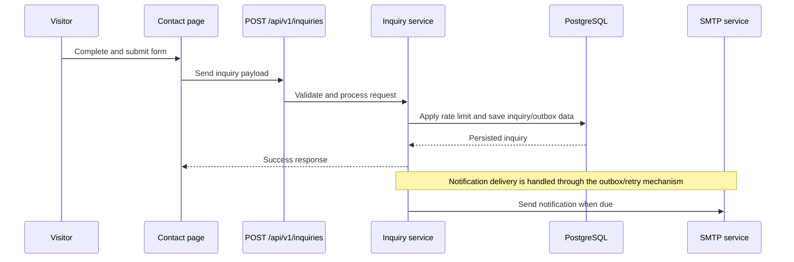
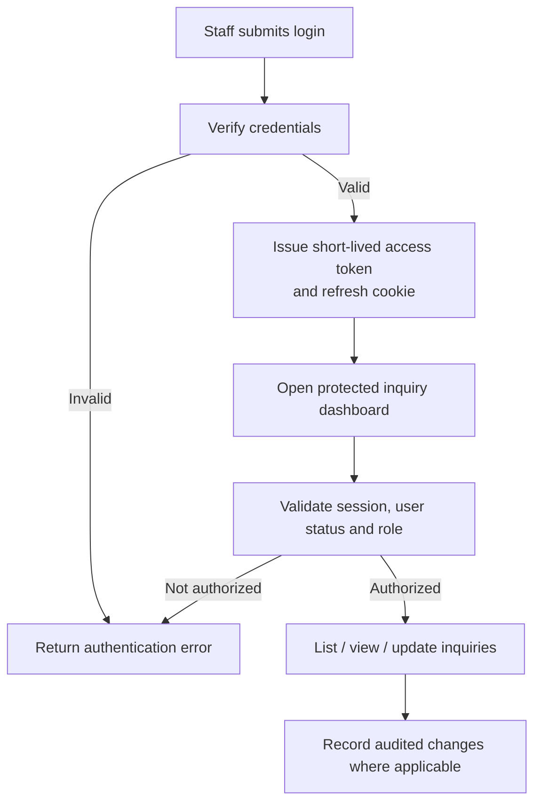
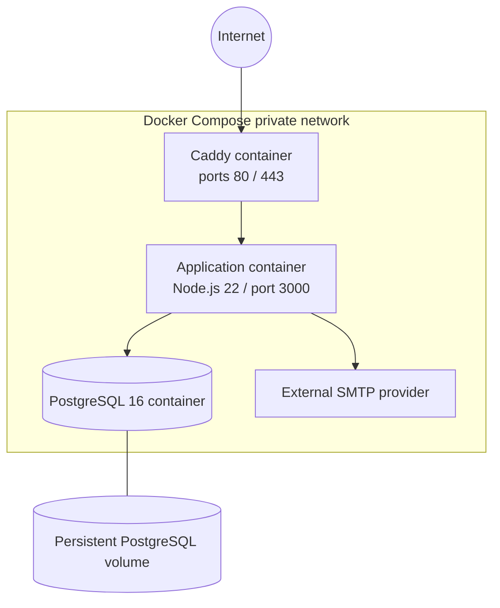

# EPAM Website — Project Architecture

This is an additional architecture overview for project stakeholders. It supplements (and does not replace) `docs/ARCHITECTURE.md`.

## 1. System context

The application is a single deployable web service. The public website and REST API share the same origin and server process. Caddy is the public-facing reverse proxy; PostgreSQL is not exposed as a public service in the provided Compose configuration.

## 2. Application layers

### Presentation layer

- `src/routes/*.tsx` contains the page-level React route components.
- `src/components/SiteLayout.tsx` provides the shared site layout.
- `src/components/ui/` contains reusable interface primitives.
- `src/styles.css` contains global styling.

### Server / application layer

- `src/routes/api.v1.*.ts` exposes HTTP endpoints and delegates work to server modules.
- `src/server/auth.server.ts`, `tokens.server.ts` and `password.server.ts` implement authentication-related behavior.
- `src/server/inquiries.server.ts` contains inquiry operations.
- `src/server/handlers.server.ts` and `api.server.ts` coordinate request handling and API behavior.
- `src/server/http.server.ts`, `env.server.ts`, `ratelimit.server.ts` and `security-headers.server.ts` provide supporting server infrastructure.
- `src/server/notifier.server.ts` handles notification delivery.

### Data layer

- PostgreSQL stores application records.
- `src/server/migrations.server.ts` contains the migration mechanism used by the running application.
- `drizzle/schema.ts` and `drizzle/migrations/` provide the Drizzle schema and migration artifacts in the repository.
- Use new forward-only migrations for future schema changes.

## 3. Main request flows

### Public inquiry

### Staff authentication and inquiry management

## 4. API surface

The API is versioned under `/api/v1` and is implemented as TanStack Start server routes. The principal endpoint groups are:

| Group | Endpoints / purpose |
|---|---|
| Public inquiries | `POST /api/v1/inquiries` |
| Authentication | `POST /api/v1/auth/login`, `/refresh`, `/logout`; `GET /api/v1/auth/me` |
| Admin inquiries | `GET /api/v1/admin/inquiries`, `GET /api/v1/admin/inquiries/{id}`, `PATCH /api/v1/admin/inquiries/{id}/status`, `DELETE /api/v1/admin/inquiries/{id}` |
| Operational | `/healthz`, `/readyz`, `/api/v1/csp-report` |
| SEO | `/sitemap.xml`, `/robots.txt` |

For request/response details and the canonical endpoint contract, use `docs/openapi.yaml` and `docs/ARCHITECTURE.md`.

## 5. Security and operational boundaries

- Caddy is the public edge and terminates HTTPS in the supplied deployment design.
- The application and database communicate on the private Compose network.
- Secrets are supplied through environment variables; `.env` must remain untracked.
- The backend validates incoming data and uses parameterized database operations.
- Authentication uses an access token and a rotating refresh-token cookie; authorization is enforced on protected staff routes.
- Rate limiting, audit logging, security headers and readiness/health endpoints are part of the server implementation.
- Inquiry notification uses an outbox/retry approach so email delivery is separate from the visitor's form submission response.

Refer to the original architecture document for the detailed token lifecycle, exact cookie settings, rate-limit policy, error codes and accepted security trade-offs.

## 6. Deployment topology

The repository includes `Dockerfile`, `docker-compose.yml` and `deploy/Caddyfile`. The intended production deployment runs the app, PostgreSQL and Caddy with persistent database storage. SMTP is an external service configured by environment variables.

## 7. Key quality gates

1. `bun run lint`
2. `bun run test`
3. `bun run build`
4. Run the documented server end-to-end checks against a test PostgreSQL database and SMTP sink.
5. Validate the deployed `/readyz` endpoint, TLS headers, inquiry submission, admin access and email notification in staging.

The build and test commands are defined in `package.json`. Deployment readiness and remaining launch tasks are documented in `docs/GO_LIVE.md`.
